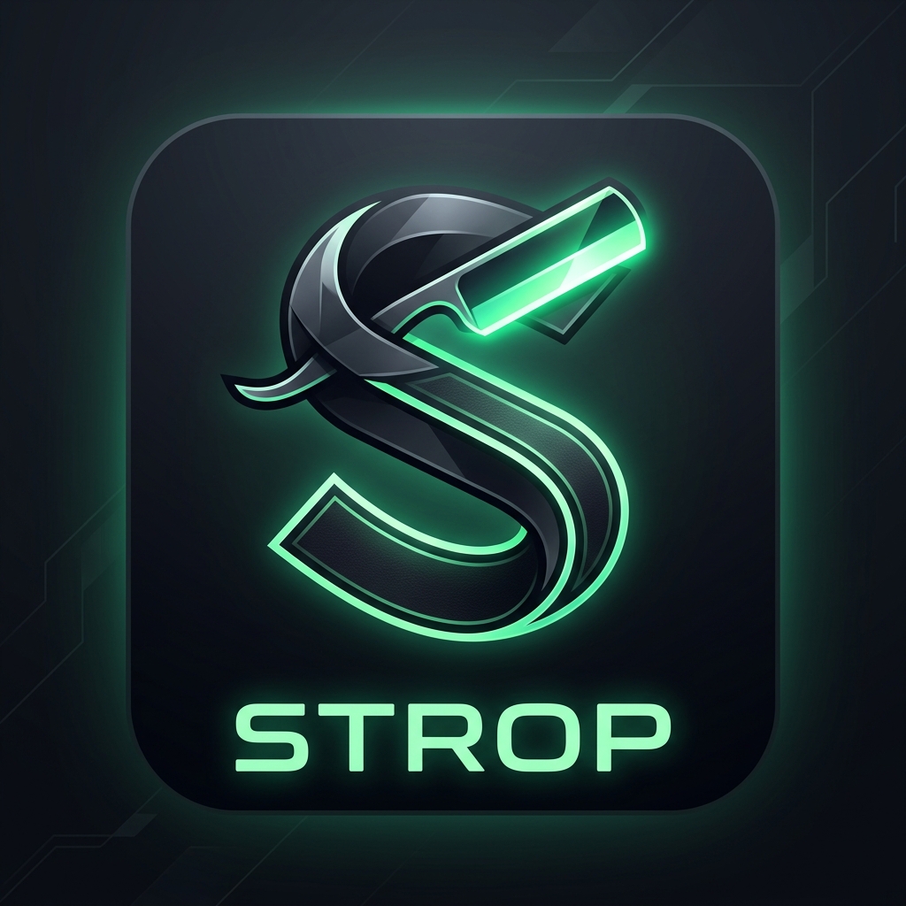

# 🗡️ Strop — Razer Linux Peripheral Suite

<div align="center">
  
  <h3>Putting the sharpest edge on your Razer gaming hardware on Linux.</h3>
  <p>Native GTK4 Remap Studios • In-Game Heads-Up Displays • Unified Device Hub • input-remapper Integration • 230+ Catalog Layouts</p>
</div>

---

## 🧰 Platform and support

The **only official 1.0 support target** is the Steam PC running Ubuntu 26.04.1 LTS, GNOME 50.1 on Wayland, Python 3.14.4, GTK 4.22.4, and input-remapper 2.2.0. The initial hardware scope is the Razer Tartarus Pro, BlackWidow V3, and Naga Trinity listed in the [support matrix](docs/SUPPORT.md). End-to-end mapping verification is still in progress.

Strop's catalog contains 230+ device entries and generic layout archetypes. Catalog presence is reference data; it does not mean a device has been tested or is officially supported. Other distributions, sessions, backend versions, and devices are outside the 1.0 support commitment.

Strop uses **Python 3**, **PyGObject**, **GTK 4**, and **python-evdev**. Hardware remapping requires **input-remapper**; OpenRazer is optional for supported lighting integration. The Debian package declares these runtime dependencies. Follow the [support and setup notes](docs/SUPPORT.md) for device permissions and session limitations.

- **Macro Studio & Composer**: Built-in gaming combos (Turbo Autofire, Slide-Jump, Ability Combos) and productivity shortcuts with custom millisecond delay composition.
- Polychromatic dark slate & emerald theme design language.


---

## 🚀 Suite Applications

### 1. **Strop Hub** (`./strop.py` or `./strop.sh`)
The central dashboard scans connected Razer input devices and launches the studios. Its 230+ entry catalog provides layout references; those devices are not thereby verified or supported.

### 2. **Strop Keypad Studio** (`./strop_keypad.py` or `./keypad.sh`)
- **Keypad Matrix**: Physical 1:1 layout (Keys 01–19, Scroll Up, Scroll Down, 8-Way D-pad, Thumb Button, Spacebar) for Tartarus Pro, Tartarus V2, Orbweaver, and Nostromo.
- **Analog Stick & Gamepad Emulation**: 1-Click mapping of D-pad to Xbox 360 Left Analog Stick (LS) or Right Analog Stick (RS) with smooth diagonal blending.
- **Auto-Detection on Execution**: Scans USB devices and calculates hardware capabilities `origin_hash`.
- **Live Key Recording / Input Capture (`[ 🔴 Capture Input ]`)**: Record physical key combinations directly.
- **Preset Importer & Exporter**: Direct integration with `input-remapper-2`.

### 3. **Strop Keyboard Studio** (`./strop_keyboard.py` or `./keyboard.sh`)
- **Full-Size Mechanical Keyboard Diagram (108 Keys)**: Complete ANSI 60% matrix, navigation/editing cluster, arrow keys, numpad, and digital multi-function media roller.
- **Layout archetypes**: Full-size, Tenkeyless (TKL), 75%, 65%, 60% Mini, and Blade laptop layouts. These are catalog/layout references; see the support matrix for verified device scope.
- **WASD Analog Stick Mapping**: 1-Click mapping of WASD to Left Analog Stick (LS).
- **Full Studio Dock**: Key inspector, input recorder, gamepad palette, and input-remapper-2 preset management.

### 4. **Strop Mouse Studio** (`./strop_mouse.py` or `./mouse.sh`)
- **Multi-Plate Modular Support**:
  - **Naga MMO 12-Button Mechanical Side Grid** (Naga Trinity / Pro / V2 / Chroma / Epic / X).
  - **Naga Hex & Radial Side Plate** (Naga Trinity Hex, Naga Hex V2).
  - **FPS & Ergonomic Side Plate** with Multi-Function DPI Clutch & Tilt-Wheel (Basilisk V3 / Pro, DeathAdder V2 / V3, Viper, Cobra, Mamba, Orochi, Abyssus).
  - **Ambidextrous Dual Side Buttons** (Viper, Ouroboros, Taipan, Lancehead).
  - **Gamepad Action Palette**: Assign controller face buttons, bumpers, and triggers.

### 5. **Strop Macro Studio** (`./strop_macro.py` or `./macro.sh`)
- **Visual Sequence Timeline**: Visual vertical step builder to insert keypresses, mouse clicks, and custom millisecond delay pauses.
- **Custom Macro Library**: Organize, search, and save custom macros directly in `~/.config/strop/macros.json`.
- **Integrated Hardware Assignment**: Any macro built in Macro Studio is instantly available for 1-click assignment across all keypads, keyboards, and mice.

### 6. **Strop Universal Parameterized Studio** (`./strop_studio.py`)
- Launch studio for any device by name:
  ```bash
  ./strop_studio.py --device="Razer Naga Pro"
  ./strop_studio.py --device="Razer Huntsman Mini"
  ./strop_studio.py --device="Razer Tartarus Pro"
  ./strop_studio.py --list
  ```

### 7. **Strop In-Game HUD Overlay** (`./strop_hud.py` or `./hud.sh`)
- **Frameless Glassmorphism Floating Window**: Unobtrusive, semi-translucent overlay that stays pinned on top of full-screen games.
- **Physical Layout Mirror**: 5-row keypad layout, aligned scroll wheel, thumb button, and D-pad.
- **Gamepad Badge Recognition**: Displays clean analog stick and controller badges (`LS↑`, `LS↓`, `(A)`, `(B)`, `LT`, `RT`, etc.).
- **Live Preset Switcher**: Switch active profiles directly in-game.

---

## 🎮 Quick Launch Commands

```bash
# Unified Hub Dashboard & 230+ Device Catalog
./strop.py

# Dedicated Macro Studio
./strop_macro.py

# Generic Keypad Studio (Tartarus / Orbweaver / Nostromo)
./strop_keypad.py

# Generic Keyboard Studio (BlackWidow / Huntsman / DeathStalker / Blade)
./strop_keyboard.py

# Generic Mouse Studio (Naga MMO / Basilisk FPS / Viper Ambi)
./strop_mouse.py

# In-Game HUD Overlay
./strop_hud.py

# Universal Studio CLI
./strop_studio.py --device="<Device Name>"
```

---

## 📦 Installation & Packaging

The official 1.0 target is Ubuntu 26.04.1 LTS on the Steam PC. Other distributions are not in the support matrix.

### Install Debian Package (.deb)
Download or build the package and install it with `apt`:
```bash
sudo apt install ./strop_0.9.2_all.deb
```

To build fresh `.deb` and `.tar.gz` release artifacts at any time:
```bash
./build_deb.sh
```

### Local User Menu Installation
```bash
mkdir -p ~/.local/share/applications ~/.local/share/icons/hicolor/256x256/apps
cp assets/strop_icon.png ~/.local/share/icons/hicolor/256x256/apps/strop.png
cp strop.desktop ~/.local/share/applications/
```

See [docs/SUPPORT.md](docs/SUPPORT.md) for the platform matrix, device scope, package requirements, permission guidance, and Wayland/XWayland limitations. Catalog models not listed there are not part of official 1.0 support.

---

## 📜 Version & License

- **Version**: `0.9.2`
- **License**: [GNU General Public License v3.0 or later](LICENSES.md) (`GPL-3.0-or-later`); full license text: [LICENSE](LICENSE).


