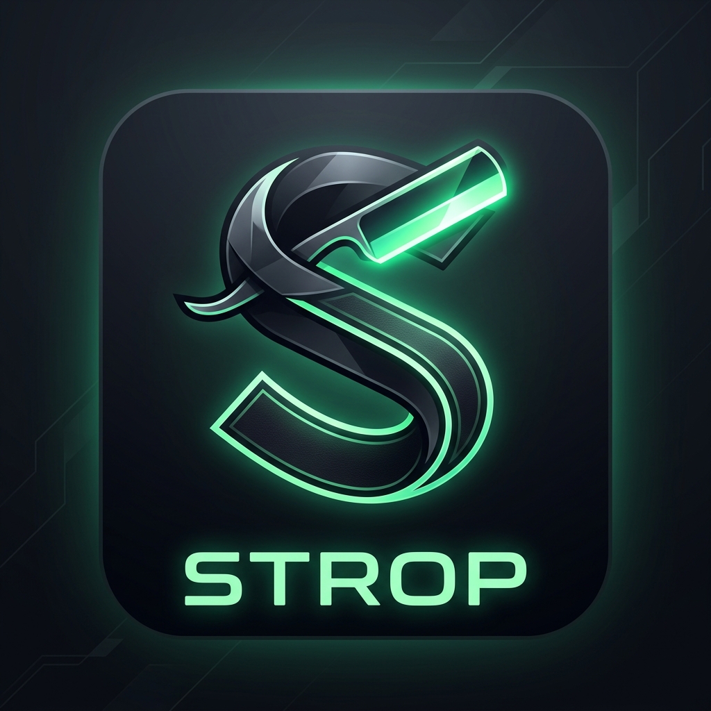
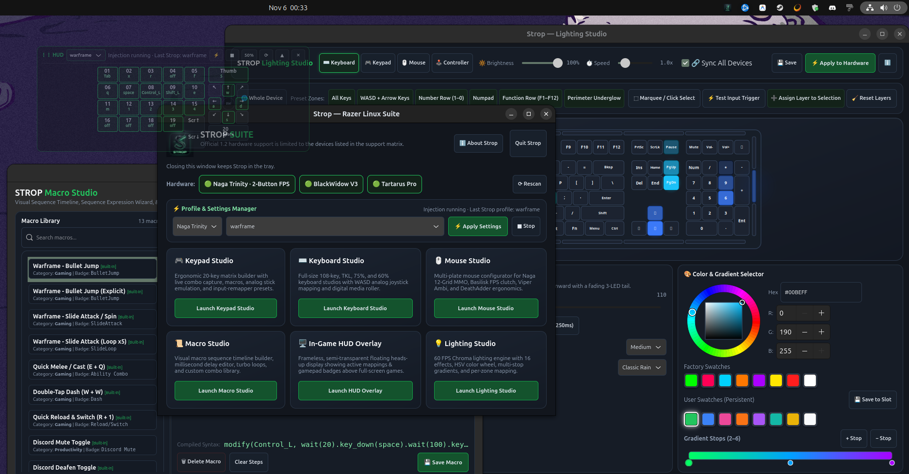

# 🗡️ Strop — Razer Linux Peripheral Suite

<div align="center">
  
  <h3>Putting the sharpest edge on your Razer gaming hardware on Linux.</h3>
  <p>Native GTK4 Remap Studios • Chroma RGB Lighting • Mouse DPI & Polling • In-Game HUDs • Powered by <a href="https://github.com/sezanzeb/input-remapper">input-remapper</a> &amp; <a href="https://openrazer.github.io/">OpenRazer</a></p>
  <p>
    <a href="https://github.com/dedmo399/strop/actions/workflows/ci.yml"></a>
    <a href="https://github.com/dedmo399/strop/releases/latest"></a>
    <a href="LICENSE"></a>
    <a href="docs/SUPPORT.md"></a>
  </p>
</div>

## Quick start

Strop is a Linux control suite for Razer devices: remap keys, tune mouse DPI and polling, build macros, edit RGB lighting, and manage HUD overlays for gameplay.

- Supported target: Ubuntu 26.04 LTS, GNOME on Wayland, Python 3.14, and GTK4 (input-remapper 2.2.0).
- Hardware scope: primarily Razer keyboards, keypads, mice, and related Linux input devices covered by the current support matrix.
- Recommended first step: install the latest release, then read the [user guide](docs/USER_GUIDE.md) and [support matrix](docs/SUPPORT.md).

### Install the latest release

Download the latest verified package and release artifacts from the [Strop releases page](https://github.com/dedmo399/strop/releases/latest).

```bash
# Example: install the current Debian package
sudo apt install ./strop_1.2.1_all.deb
```

For setup steps and troubleshooting, see [docs/USER_GUIDE.md](docs/USER_GUIDE.md) and [docs/SUPPORT.md](docs/SUPPORT.md).

---

## New here?

If you are testing Strop for the first time, use this flow:

1. Check the [support matrix](docs/SUPPORT.md) to confirm your platform and device are covered.
2. Install the current release from [GitHub Releases](https://github.com/dedmo399/strop/releases/latest).
3. Launch the Hub with `./strop.py` or the installed desktop entry.
4. Read the [user guide](docs/USER_GUIDE.md) before changing mappings, macros, or lighting profiles.
5. Report issues through the [issue tracker](https://github.com/dedmo399/strop/issues).

---



---

## AI disclosure and disclaimer

Strop was created with substantial assistance from generative AI, including AI-generated code and documentation. AI assistance is part of the project's development process and may also be used for documentation, automation, and project management tasks.

AI-generated work can contain bugs, incorrect assumptions, and inaccurate descriptions of hardware or software behavior. The use of AI does not establish that the code has received an independent review or formal validation.

The maintainer remains responsible for what is accepted and released. Please evaluate Strop against your own needs, back up your remapping profiles before making changes, and report problems through the issue tracker.

---

## Source repository

The primary source for Strop is [dedmo399/strop on GitHub](https://github.com/dedmo399/strop). The `main` branch is the canonical development branch.

Clone the repository over HTTPS:

```bash
git clone https://github.com/dedmo399/strop.git
cd strop
```

For an existing checkout, get the latest committed source with `git pull --ff-only` on `main`. To propose a change, follow [CONTRIBUTING.md](CONTRIBUTING.md). Generated `.deb` and `.tar.gz` release artifacts can be rebuilt with [build_deb.sh](build_deb.sh).

---

## 🧰 Platform and support

The **only official 1.2 support target** is Ubuntu 26.04 LTS, GNOME on Wayland, Python 3.14, and GTK4, with input-remapper 2.2.0. The hardware scope remains the Razer Tartarus Pro, BlackWidow, Huntsman, Naga, Basilisk, and comparable supported inputs listed in the support matrix.

Strop's catalog contains 230+ device entries and generic layout archetypes. Catalog presence is reference data; it does not mean a device has been tested or is officially supported. Other distributions, desktop environments, or device families may work but are not in scope for support commitments.

Strop uses **Python 3**, **PyGObject**, **GTK 4**, and **python-evdev**. Hardware remapping requires [**input-remapper**](https://github.com/sezanzeb/input-remapper); [**OpenRazer**](https://openrazer.github.io/) is used for lighting and device control.

- **Macro Studio & Composer**: Built-in gaming combos such as Bullet Jump and Ability Combos, plus productivity shortcuts with custom millisecond delays.
- **Unified RGB Lighting & Chroma Effects Studio**: 60 FPS internal render loop, 16 lighting presets, interactive Cairo HSV color wheel + SV square, multi-stop gradient editor, and 2D vector zone mapping.
- **Mouse DPI & Polling Rate Controller**: OpenRazer hardware sensor capability discovery, X/Y DPI and stage table editors, polling rate selection, and per-device persistence.
- Polychromatic dark slate & emerald theme design language.

---

## 🚀 What Strop can do

### Hub, remapping, and profiles

Use the Hub to discover devices, open studios, apply saved profiles, and manage the tray applet and HUD overlays.

### Keypad, keyboard, and mouse studios

Open dedicated studios for hardware-specific layouts and device controls:

- Keypad remapping and layouts
- Keyboard remapping and layout presets
- Mouse DPI, polling, and button assignment
- Macro composition and assignment
- RGB lighting profiles and effect editing
- In-game HUD overlays

### Quick launch commands

```bash
# Unified Hub Dashboard & 230+ Device Catalog
./strop.py

# Dedicated Macro Studio
./strop_macro.py

# Unified RGB Lighting & Chroma Effects Studio
./strop_lighting.py

# Generic Keypad Studio (Tartarus / Orbweaver / Nostromo)
./strop_keypad.py

# Generic Keyboard Studio (BlackWidow / Huntsman / DeathStalker / Blade)
./strop_keyboard.py

# Generic Mouse Studio (Naga MMO / Basilisk FPS / Viper Ambi)
./strop_mouse.py

# In-Game HUD Overlay
./strop_hud.py

# Universal Studio CLI
./strop_studio.py --device="<Device Name>"
```

---

## 📦 Installation & Packaging

The official 1.2 target is Ubuntu 26.04 LTS, GNOME on Wayland, Python 3.14, and GTK4. Other distributions are not in the support matrix.

### Install Debian Package (.deb)

Download `strop_1.2.1_all.deb`, `strop_1.2.1.tar.gz`, and `SHA256SUMS` from the [Strop 1.2.1 release](https://github.com/dedmo399/strop/releases/tag/v1.2.1) into the same directory. Verify both downloads before installation:

```bash
sha256sum --check SHA256SUMS
```

Both files should report `OK`. Checksums detect corrupted or changed downloads; they are not an independent signature of the release. If verification fails, download the files again before proceeding.

Install the verified Debian package with `apt`:

```bash
sudo apt install ./strop_1.2.1_all.deb
```

To build fresh `.deb` and `.tar.gz` release artifacts at any time:

```bash
./build_deb.sh
```

Source checkout launchers use the `./strop*.py` commands above. To add an installed package to the application menu, install the `.deb`; it provides a system desktop entry and icons.

See [docs/USER_GUIDE.md](docs/USER_GUIDE.md) for first-run and profile steps. [docs/SUPPORT.md](docs/SUPPORT.md) lists the platform matrix, device scope, package requirements, permission guidance, and troubleshooting notes.

The active [Strop roadmap](ROADMAP.md) details completed milestones and the 2.0 plan for Tartarus Pro key-depth access, controller outputs, and hardware settings built on input-remapper and OpenRazer.

---

## 🙏 Acknowledgments & Upstream Projects

Strop builds upon the foundational work of the Linux input and hardware community:

- **[input-remapper](https://github.com/sezanzeb/input-remapper)** by [Sezanzeb](https://github.com/sezanzeb) and contributors — Provides the underlying Linux `evdev`/`uinput` remapping service and the stable device-mapping workflow Strop uses.
- **[OpenRazer](https://openrazer.github.io/)** ([openrazer/openrazer](https://github.com/openrazer/openrazer)) by the OpenRazer contributors — Provides the open-source Linux kernel drivers and daemon used for lighting and sensor control.
- **[GTK 4](https://www.gtk.org/)**, **[PyGObject](https://pygobject.gnome.org/)**, **[Cairo](https://www.cairographics.org/)**, and **[python-evdev](https://github.com/gvalkov/python-evdev)** — The core toolkit, bindings, rendering, and input layers that power the Linux desktop experience.

*Strop is an independent open-source project and is not affiliated with, endorsed by, or sponsored by Razer Inc.*

---

## Help and contributions

For setup and troubleshooting, read the [user guide](docs/USER_GUIDE.md) and [support matrix](docs/SUPPORT.md). Report ordinary bugs through the [issue tracker](https://github.com/dedmo399/strop/issues). To contribute code or documentation, see [CONTRIBUTING.md](CONTRIBUTING.md).

---

## 📜 Version & License

- **Version**: `1.2.1`
- **License**: [GNU General Public License v3.0 or later](LICENSES.md) (`GPL-3.0-or-later`); full license text: [LICENSE](LICENSE).

Maintained by Strop Contributors. Source and issue tracking: [dedmo399/strop](https://github.com/dedmo399/strop).
